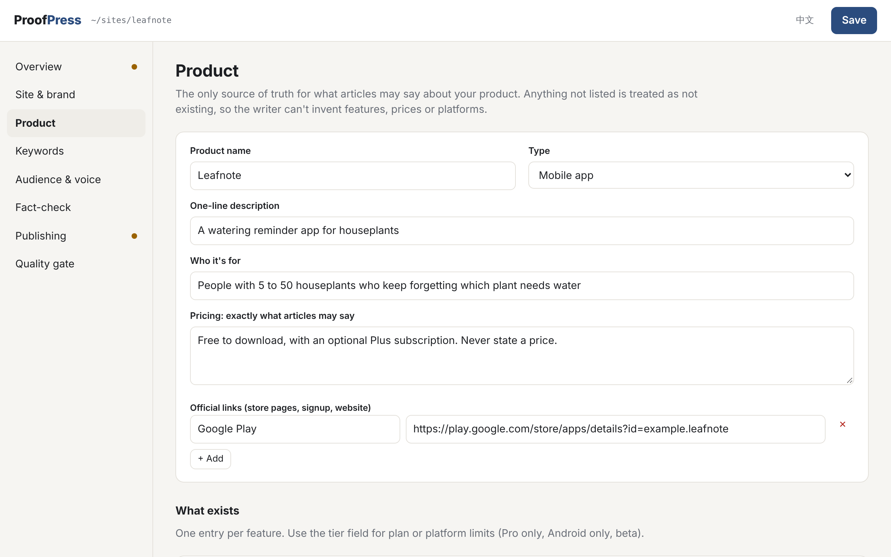
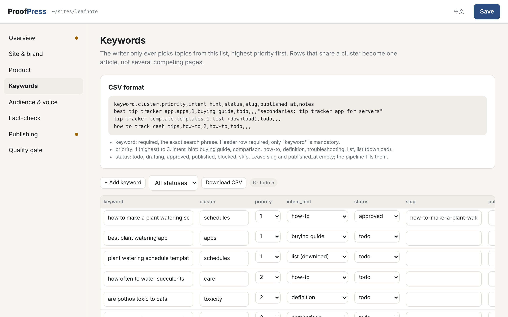
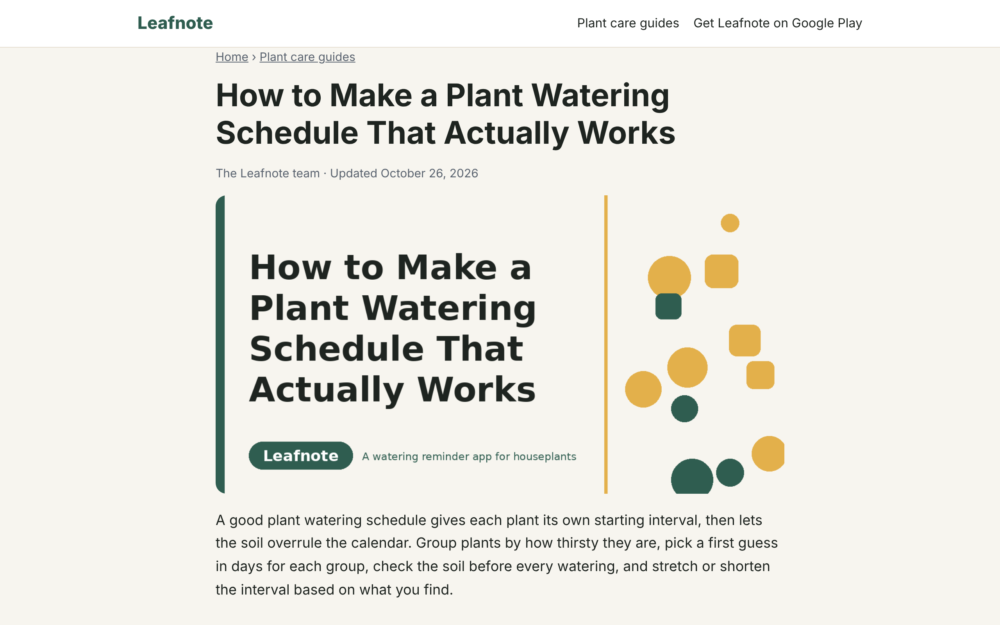
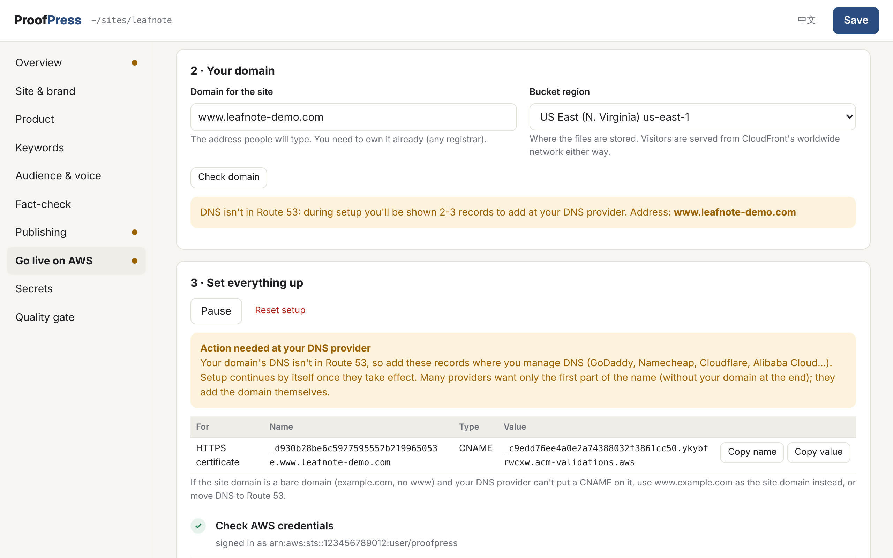

# ProofPress

**A fact-checked SEO article pipeline for AI agents.** You describe your product and list your keywords in a settings page. Your agent (Claude Code, Codex, Cursor, Claude Desktop...) then writes one article at a time and has to get it past a set of gates before anything is published:

- **Product truth:** the writer may only claim what your product definition lists. Anything not listed is treated as not existing, so it can't invent features, prices or platforms.
- **Live fact-checks:** claims you mark as sensitive (taxes, health, laws, other products' prices) must be verified against approved sources during the run, or they're cut.
- **Anti-slop:** a mechanical scanner plus two reading passes remove hype words, filler, fake hooks and robotic rhythm.
- **Independent scoring:** a reviewer that didn't write the draft scores it out of 100. Below your pass mark it gets rewritten; after the maximum rewrites it comes back to you instead of going live.

Then ProofPress draws a hero image and publishes: either a complete static site (homepage, blog index, sitemap, schema, internal links) deployed to S3, Cloudflare Pages, Netlify, Vercel or any git-connected host, or straight into the site you already have (Astro/Hugo/Next Markdown repo, WordPress, or any webhook).

It's one folder: a Python engine with no required dependencies, a local settings UI, a Claude skill and an MCP server.







```
proofpress/
├── cli/proofpress            CLI (no install step)
├── cli/proofpress-mcp        MCP server launcher
├── proofpress/               engine + settings UI (Python 3.9+, standard library)
├── skills/proofpress/        the agent skill: pipeline + reference playbooks
├── mcp/server.py             MCP server (stdio)
├── .claude-plugin/           Claude Code plugin (skill + MCP server) + marketplace manifest
├── examples/demo-project/    a filled-in fictional project you can build right away
└── docs/                     deploy guides
```

## Quick start (5 minutes)

```bash
git clone https://github.com/BenHugh/proofpress.git
cd proofpress
./install.sh                      # CLI on PATH, markdown + pillow, skill + MCP for Claude Code
source ~/.zshrc                   # or open a new terminal, so the `proofpress` command is found

# Try the demo first: build the fictional "Leafnote" site and open it
proofpress build --project examples/demo-project
python3 -m http.server 8000 --directory examples/demo-project/public   # open http://localhost:8000

# Your own project
proofpress init ~/sites/my-product --name "My Product"
proofpress ui --project ~/sites/my-product
```

`proofpress ui` opens a settings page in your browser. Fill in the tabs, press Save, and the Overview tab tells you what's still missing.

Then, in Claude Code:

> Use proofpress to write the next article for ~/sites/my-product

## The settings page

Everything project-specific is entered here, never hard-coded:

| Tab | What you fill in | Becomes |
|---|---|---|
| Site & brand | name, URL, language, blog path, colours, call-to-action buttons | `proofpress.json` |
| Product | one-liner, audience, official links, the exact pricing sentence, **features with tier/platform limits**, **what does NOT exist**, positioning, disclosure line, phrasing rules | `context/product.md` |
| Keywords | add rows, paste or upload CSV (format shown on the page), filter, download | `backlog.csv` |
| Audience & voice | reader, tone, do / don't, a sample paragraph | `context/voice.md` |
| Fact-check | YMYL switch, claims that must be verified, approved sources, extra rules, disclaimer | `context/factcheck.md` |
| Publishing | new static site + host, or existing site + target; test buttons (build, dry run, publish) | `proofpress.json` |
| Quality gate | pass mark, max rewrites, extra banned phrases | `proofpress.json` |

The page runs only on `127.0.0.1`, with a per-session token. API keys and passwords go in the **Secrets** tab: they're saved only on your computer in the project's `.proofpress/` folder (git-ignored) and never written to `proofpress.json`. An environment variable with the same name takes priority.

Prefer editing files? `proofpress.json` and `backlog.csv` are plain files; tick "Manual mode" on a context section to hand-edit its Markdown instead.

### Keyword CSV format

```csv
keyword,cluster,priority,intent_hint,status,slug,published_at,notes
best plant watering app,apps,1,buying guide,todo,,,"secondaries: plant care app"
plant watering schedule template,schedules,1,list (download),todo,,,
```

Only `keyword` is required. `priority` 1 to 3 (1 = first). `intent_hint`: buying guide, comparison, how-to, definition, troubleshooting, list, list (download). `status`: todo, drafting, approved, published, blocked, skip. Rows sharing a `cluster` become one article.

## Using it from an agent

### Claude Code (plugin)

```bash
claude plugin marketplace add BenHugh/proofpress
claude plugin install proofpress@proofpress
```

That installs the skill and the MCP server together. Or run `./install.sh --skill --mcp` from a clone.

### Any MCP client (Claude Desktop, Cursor, Windsurf, Codex...)

```json
{
  "mcpServers": {
    "proofpress": {
      "command": "python3",
      "args": ["/absolute/path/to/proofpress/mcp/server.py"],
      "env": { "PROOFPRESS_PROJECT": "/absolute/path/to/your/project" }
    }
  }
}
```

The server's `get_instructions` tool returns the full playbook, so clients without skill support still follow the same pipeline. Tools: `project_status`, `read_context`, `backlog_list/next/update/add`, `list_articles`, `save_draft_file`, `read_draft_file`, `slop_scan`, `approve_article`, `make_hero_image`, `build_site`, `publish`, `init_project`.

### Other agents (skills only)

Copy `skills/proofpress/` to wherever your agent loads skills from (for Claude Code that's `~/.claude/skills/`). The skill calls the `proofpress` CLI, so put `cli/` on your PATH too (`./install.sh --cli`).

## Go live on AWS without the command line

Open the **Go live on AWS** tab in the settings page:

1. **Connect your AWS account.** Paste an access key (the page walks you through creating an IAM user and shows the exact minimal policy to copy), or pick an AWS CLI profile already on your computer. Press *Save and test connection*.
2. **Enter your domain**, e.g. `www.example.com`, and press *Check domain*.
3. **Press *Start automatic setup*.** In your own AWS account, ProofPress creates a private S3 bucket, an HTTPS certificate (ACM), a CloudFront distribution with a URL-rewrite function, the DNS records, then builds and uploads the site and checks it answers on `https://`. Progress shows step by step; it resumes where it stopped if interrupted.

If the domain's DNS is in Route 53, it's fully automatic (the www and bare domain are both set up, one redirecting to the other). If DNS is elsewhere (GoDaddy, Namecheap, Cloudflare...), the page lists the 2-3 records to add there and carries on by itself once they're live.



After that, every publish uploads to the new site. A small site typically costs well under a dollar a month on AWS.

## Publishing targets

**New static site** (`Publishing > Build a new static site`)

| Host | Needs |
|---|---|
| AWS S3 + CloudFront | the **Go live on AWS** tab sets it all up from your domain (manual route in [docs/deploy.md](docs/deploy.md#aws-s3--cloudfront)) |
| Cloudflare Pages | Node.js, `CLOUDFLARE_API_TOKEN` |
| Netlify | Node.js, `NETLIFY_AUTH_TOKEN` |
| Vercel | Node.js, `VERCEL_TOKEN` |
| Git repo | a repo your host deploys on push (Cloudflare Pages, Netlify, Vercel, GitHub Pages) |
| None | build only; upload `public/` anywhere |

**Existing site** (`Publishing > Add to my existing site`)

| Target | What happens |
|---|---|
| Markdown repo | writes `src/content/blog/<slug>.md` (path configurable) with Astro, Hugo or plain frontmatter, copies the hero image, commits, optionally pushes |
| WordPress | creates/updates the post via REST API (draft by default), uploads the featured image; needs `WP_APP_PASSWORD` (an Application Password) |
| Webhook | POSTs JSON with markdown, html, frontmatter, JSON-LD and the hero image to any URL (Zapier, Make, n8n, your API) |

Always try **Dry run** first: it prints the exact commands or requests without uploading anything.

## CLI reference

```
proofpress init <dir> [--name NAME]
proofpress ui        [--project DIR] [--port 8765]
proofpress status    [--project DIR]
proofpress backlog list|next|set|add [--keyword K --status S --cluster C --priority 1-3 --intent I --notes N]
proofpress articles
proofpress scan <draft.md> [--keyword K] [--lang en]
proofpress approve --slug SLUG [--draft draft-2.md]
proofpress hero --slug SLUG [--title T]
proofpress build
proofpress deploy  [--dry-run]
proofpress publish [--slug SLUG] [--dry-run]
```

`--project` defaults to `$PROOFPRESS_PROJECT`, then the current folder.

## Project folder

```
my-site/
├── proofpress.json            settings (from the UI)
├── backlog.csv                keywords
├── context/                   product.md, voice.md, factcheck.md (generated)
├── content/articles/<slug>.md approved articles
├── content/drafts/<slug>/     brief, sources, drafts, scans, scorecards
├── static/                    images/, downloads/, optional index.html
├── public/                    build output (static-site mode)
└── .proofpress/               publish state
```

A custom homepage: put your own `static/index.html` with `<!-- PROOFPRESS:ARTICLES:START -->` and `<!-- PROOFPRESS:ARTICLES:END -->` where the latest articles should appear.

## Requirements

- Python 3.9+ (macOS and most Linux already have it)
- Optional: `markdown` (HTML builds, WordPress, webhook) and `pillow` (hero images): `pip install -r requirements.txt`
- Node.js only for the Cloudflare / Netlify / Vercel direct-upload hosts
- An agent that can browse the web, for SERP checks and live fact-checks

## What it won't do

It won't pick topics on its own, add keywords you didn't approve, publish a draft that failed the gate, or store your secrets. It doesn't guarantee rankings: it makes each article honest, specific and useful, which is the part you control.

## License

[Functional Source License 1.1, Apache 2.0 Future License](LICENSE) (FSL-1.1-ALv2), the same family of license Typebot and Sentry use. It's Fair Source rather than OSI open source:

- **Allowed:** using it for your own sites and your company's sites, modifying it, sharing it, teaching with it, doing client SEO work with it.
- **Not allowed:** offering it, or something substantially similar built from it, as a competing commercial product or hosted service.
- **Two years after each release**, that version automatically becomes Apache 2.0 with no restrictions.

Articles you write with ProofPress are yours.

[中文说明](README.zh-CN.md)
